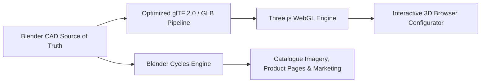
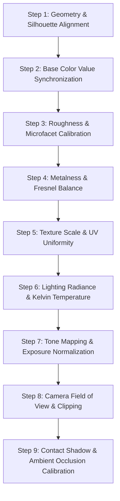

# Hybrid Rendering Pipeline Specification — Everdale Platform (Phase 01)

**Document Version:** 1.0.0  
**Status:** Approved Pipeline Standard  
**Author:** 3D Technical Director & Lead Visualisation Specialist  
**Pipeline Components:** Blender Cycles (Offline Photorealism) + Three.js WebGL (Interactive Real-Time)  
**Date:** November 2026  

---

## 1. Executive Summary

The Everdale commercial platform employs a **Hybrid Rendering Strategy**. Rather than forcing a single rendering engine to compromise between real-time browser performance and ultra-photorealistic marketing imagery, the platform divides responsibilities between two specialized, complementary rendering tiers:

1. **Real-Time Tier (Three.js WebGL)**: Sub-second interactive configuration, 360° orbit, and kinematic drawer animations inside customer browsers.
2. **Offline Photorealistic Tier (Blender Cycles)**: High-resolution, path-traced lifestyle photography, studio hero stills, and dimensional marketing collateral.

The single source of truth for all product geometry and physical proportions is the **Approved Blender CAD/DCC Model**.

---

## 2. Tier Comparison & Technical Specifications

| Criterion | Tier 1: Real-Time Browser Configurator | Tier 2: Offline Photorealistic Renderer |
| :--- | :--- | :--- |
| **Primary Engine** | Three.js (r170) / WebGL 2.0 | Blender 5.x / Cycles Path Tracer |
| **Target Frame Rate** | Constant 60 FPS | Pre-rendered still frames (30s – 2min per frame) |
| **Output Resolution** | Dynamic viewport (up to $3840 \times 2160$ DPR 2.0) | $4096 \times 4096$ (Hero), $2560 \times 1440$ (E-Comm) |
| **Global Illumination** | PMREM Image-Based Radiance + Directional Fill | Full Monte Carlo multi-bounce path tracing (12+ bounces) |
| **Shading Model** | WebGL standard Cook-Torrance microfacet BRDF | Principled BSDF v2 with full subsurface & micro-roughness |
| **Light Transport** | Approximation (PCF soft shadows, screen bloom) | Physically correct photon dispersion, caustics, soft penumbras |
| **Customer Purpose** | Instant tactile visual feedback during option selection | Commercial confidence, hero banners, print & catalog PDFs |

---

## 3. The Source of Truth: Blender Production Workspace

1. **Master Blender Geometry**:
   - Every product is modeled to manufacturing tolerances in millimeters.
   - Drawer slide pockets, bevel radiuses ($1.0\text{ mm}$ edge breaks), undermount slide clearances, and sink basin curvatures are physically modeled.
2. **glTF Asset Generation**:
   - `generate_all_sizes.py` programmatically derives parametric size variants from the master file.
   - Transforms are applied, modifiers evaluated, and NLA animation tracks exported cleanly.
   - Geometry is NEVER recreated procedurally or generatively in JavaScript.

---

## 4. Cross-Engine Visual Calibration Framework

To maintain brand consistency between offline catalogue imagery and the interactive web viewer, assets undergo a standardized **Nine-Point Calibration Protocol**:

### 4.1 Calibration Steps Explained
1. **Geometry & Silhouette**: Verify that glTF exports match the Blender original within $0.01\text{ mm}$.
2. **Base Color Synchronization**: Linear sRGB hex values in `productConfig.js` must match Blender Principled BSDF base color inputs (`#899281` for Evergreen Fog).
3. **Roughness Mapping**: WebGL microfacet roughness values are calibrated against Cycles roughness curves (e.g. cabinet body calibrated at $0.42$).
4. **Metalness & Specular**: Hardware finishes (Antique Brass, Brushed Nickel) use matched metalness ($0.88$) and IOR ($1.5$).
5. **Texture Scale**: Procedural marble/quartz canvas generation must match physical tile and slab veining scales.
6. **Lighting Radiance**: Three.js HDRIs (`studio_small_09_1k.hdr`) must match Blender world background HDRI orientations and lux ratings.
7. **Tone Mapping Curve**: Both engines utilize ACES-compliant curves (`ACESFilmicToneMapping` in Three.js, AgX/Filmic in Blender).
8. **Camera Optics**: Lens focal lengths ($36^\circ$ FOV in Three.js $\approx 35\text{ mm}$ full-frame equivalent in Blender) ensure identical perspective compression.
9. **Contact Shadows**: Three.js directional light shadow bias ($-0.0003$, normal bias $0.02$) is tuned to prevent shadow acne while retaining crisp leg contact shadows.

---

## 5. Separation of Product vs Environment Materials

To allow the vanity to be placed in any architectural room without corrupting its product materials:
- **Product Materials** (`cabinet`, `legs`, `hardware`, `countertop`, `sink`):
  - Retain strictly defined manufacturer PBR values.
  - Never receive scene-specific ambient color overrides.
- **Environment Materials** (`wall`, `floor`, `sconces`, `accessories`):
  - Handled by independent procedural sub-builders (`BathroomRoomBuilder.js`).
  - Swapping wall/floor presets does not trigger re-rendering of product shaders.
