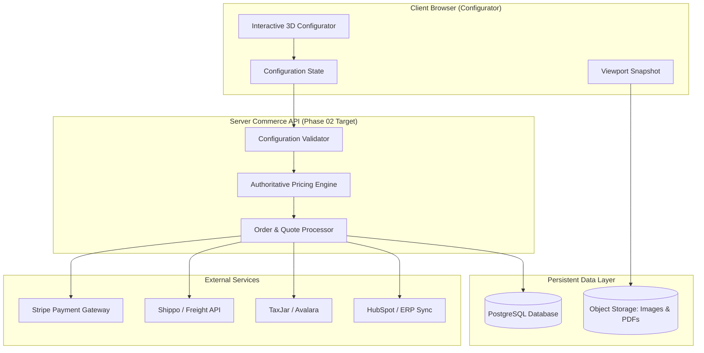

# Commercial Engine & Production Gap Analysis — Everdale Platform (Phase 01)

**Document Version:** 1.0.0  
**Status:** Architecture Gap Assessment Complete  
**Author:** Principal Full-Stack Architect & E-Commerce Lead  
**Scope:** Direct Purchase, Custom Quotation, Saved Configurations & Order Pipelines  
**Date:** November 2026  

---

## 1. Executive Summary

The existing Everdale application excels as an interactive 3D visualizer and product configurator. However, its commercial capabilities (cart, saved projects, checkout, quotation, and augmented reality) are currently implemented as **frontend client-side prototypes**.

This document outlines the gap analysis between the existing demonstration features and a production-grade luxury e-commerce platform supporting direct purchasing and custom B2B/B2C quotations.

---

## 2. Current Implementation vs Production Reality

| Functional Area | Current Frontend Prototype | Production Commerce Requirement | Gap Severity |
| :--- | :--- | :--- | :---: |
| **Cart Storage** | Transient React state array (`cartItems = []`) in `App.jsx`. Clears on refresh. | Persistent database-backed shopping cart with session sync across devices. | **CRITICAL** |
| **Pricing Calculation** | Client-side JavaScript evaluation in `productConfig.js` (`calculatePricing()`). | Server-authoritative price calculation with cryptographic token signing before checkout. | **CRITICAL** |
| **Checkout Flow** | `onClick` triggers demo toast (`Order / Quote summary submitted`) and empties state. | PCI-compliant Stripe/Adyen hosted checkout, address validation, shipping rates, and tax. | **CRITICAL** |
| **Quotation Pipeline** | Simulated notification toast; zero data persistence or transmission. | Form capture, PDF specification sheet generation, CRM/admin dashboard notification. | **HIGH** |
| **Saved Projects** | Single boolean flag (`isSaved = false`) toggled in memory. | Multi-item customer project boards, saved configuration URLs, version compatibility. | **HIGH** |
| **Augmented Reality** | Static procedural SVG QR matrix generated offline. | Dynamic USDZ (iOS AR Quick Look) and WebXR GLB delivery with dimensioned scale anchors. | **MEDIUM** |
| **Inventory / Showroom** | Hardcoded stock count ($4$) and simulated SKU lookup toast. | Real-time ERP / warehouse stock inventory API with geolocated store pickup availability. | **MEDIUM** |

---

## 3. Detailed Gap Breakdown

### 3.1 Direct Purchase Requirements (Phase 02+)
1. **Persistent Cart**:
   - Must persist items in `localStorage` for anonymous visitors and sync to a database table `carts` / `cart_items` upon user login.
   - Support multiple unique configurations with quantity adjustment and line-item option breakdowns.
2. **Authoritative Pricing**:
   - Pricing calculated on the client must be re-validated on the backend prior to payment authorization.
   - Price formulas must factor in variant width, finish upcharges, countertop materials, faucet hardware count, and promotional rebate validation.
3. **Checkout & Payment**:
   - Integration with Stripe Elements or Stripe Checkout.
   - Handling freight shipping calculation for oversized furniture ($24″\text{ to }61″$ vanities require LTL freight with liftgate service).
   - Automated sales tax calculation based on destination postal code.

### 3.2 Custom Quotation Pipeline (Phase 02)
For commercial designers, contractors, and Semi-Custom orders:
1. **Quote Request Form**:
   - Customer information: Name, Email, Phone, Company, Project Type, Estimated Delivery Date.
   - Configuration summary: Render snapshot, exact SKU, physical dimensions, finishes, and hardware selections.
2. **Quote Engine API**:
   - Endpoint `POST /api/v1/quotes` storing request in PostgreSQL `quotes` table.
   - Automated generation of a co-branded PDF spec sheet containing 2D dimensioned schematics and render snapshot.
   - Webhook notification to sales team (Slack / Email / CRM).
3. **Quotation Management Dashboard**:
   - Admin view allowing sales reps to review, price custom adjustments, approve discounts, and issue binding payment links.

### 3.3 Saved Projects & Shared Configurations
1. **Saved Project Boards**:
   - Allow homeowners and interior architects to save multiple configurations under named projects (e.g. "Master Bath Remodel", "Powder Room Option B").
2. **Shareable Permalink Architecture**:
   - Short URLs (`everdale.com/c/x9J2k1L`) pointing to a persistent snapshot record in the database, avoiding lengthy fragile query strings.
3. **Catalog Versioning**:
   - If finishes or SKUs are retired, saved permalinks must continue to resolve accurately with historical compatibility fallbacks.

---

## 4. Phase 01 Boundary & Phase 02 Staging

- **Phase 01 Boundary**: No database, payment gateway, or backend commerce code will be implemented in Phase 01. Phase 01 focuses strictly on visual stability, concurrency safety, and technical documentation.
- **Phase 02 Staging**: In Phase 02, database schemas, server-side configuration validation, and persistent quote capture will be introduced incrementally without breaking the existing front-end configurator.
