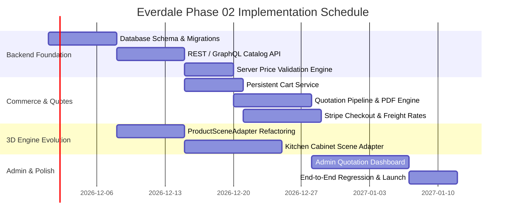

# Phase 02 Implementation Roadmap & Architectural Plan — Everdale Platform

**Document Version:** 1.0.0  
**Status:** Approved for Implementation  
**Author:** Enterprise Solutions Architect & Technical Project Lead  
**Next Stage:** Phase 02 — Data Persistence, Backend Architecture & Commerce Integration  
**Date:** November 2026  

---

## 1. Executive Roadmap Summary

Following the successful completion of **Phase 01 (Audit, Stabilization & Architectural Foundation)**, Phase 02 transitions the Everdale platform from a standalone frontend visualizer into a full-stack, multi-category furniture commerce application.

### Core Objectives for Phase 02
1. **Full-Stack Persistence Layer**: Deploy a scalable relational database (PostgreSQL via Supabase or custom API) to store products, variants, options, customer project boards, and orders.
2. **Authoritative Commerce Engine**: Implement server-side configuration validation and price calculations, preventing client-side price tampering.
3. **B2B / B2C Custom Quotation System**: Introduce structured quote request capture, automated dimensioned PDF spec sheet generation, and an administrative quotation dashboard.
4. **Persistent Shopping Cart & Checkout**: Implement multi-item persistent cart storage and Stripe checkout integration with freight shipping calculation.
5. **Multi-Category Expansion**: Introduce the first **Everdale Kitchen Cabinet Series** using the `ProductSceneAdapter` interface without modifying the vanity scene manager.

---

## 2. Phase 02 Workstream Breakdown

---

## 3. Workstream Details

### Workstream A: Backend & Persistence Foundation
- **Target Tech Stack**: Node.js / TypeScript, PostgreSQL, Prisma ORM or Supabase.
- **Deliverables**:
  - `database/migrations/`: Initial migrations implementing `products`, `product_variants`, `product_options`, `product_assets`, `carts`, `quotes`, and `orders`.
  - `api/v1/catalog`: Endpoints providing paginated product listings, individual product specifications, and variant definitions.
  - `api/v1/pricing/validate`: Server-side endpoint validating option combinations and returning tamper-proof price calculations.

### Workstream B: Commerce & Custom Quotation Pipeline
- **Target Deliverables**:
  - **Persistent Cart Service**: Anonymous `session_id` cookies storing cart items in PostgreSQL; automatically merges into customer account upon login.
  - **Custom Quotation Engine**:
    - Customer submits configured vanity or kitchen cabinetry.
    - Node.js PDF service (`pdf-lib` / `canvas`) renders a high-resolution 2-page specification sheet with customer details, SKU, dimensional drawings, and Three.js snapshot render.
    - Stores quote with unique reference token (`EV-Q-2026-1042`).
  - **Payment & Freight Integration**:
    - Stripe PaymentIntent integration with webhooks.
    - Shipping freight calculation API (LTL freight with curbside / room-of-choice liftgate delivery options).

### Workstream C: 3D Scene Adapter Layer & Kitchen Cabinet Launch
- **Target Deliverables**:
  - Abstract `ProductSceneAdapter` base class in `src/three/core/`.
  - Refactor `VanitySceneManager` into `VanitySceneAdapter` extending `ProductSceneAdapter`.
  - Author and import the first **Everdale Kitchen Base Cabinet (36″)** model (`Everdale_Kitchen_Base_36.glb`).
  - Implement `KitchenCabinetSceneAdapter` supporting door hinge rotation kinematics, cutlery drawer pullouts, and interchangeable door profiles (Shaker vs Slab).

### Workstream D: Admin Operations Dashboard
- **Target Deliverables**:
  - Lightweight administrative dashboard (`apps/admin` or protected `/admin` route).
  - Features:
    - View and filter incoming quote requests.
    - Review customer 3D configuration snapshots and selected finishes.
    - Adjust custom pricing or apply promotional trade discounts.
    - Issue binding payment links via email.

---

## 4. Risk Mitigation & Backward Compatibility Rules

1. **Zero Downtime for Existing Configurator**:
   - The existing vanity configurator must remain fully functional throughout Phase 02.
   - If the backend API is unreachable, the frontend must gracefully degrade to local JSON catalog definitions (`productConfig.js`).
2. **Semantic Adapter Independence**:
   - Never inject kitchen cabinet rules into vanity code.
   - All category-specific logic resides strictly within that category's adapter.
3. **Automated Testing Gates**:
   - Each phase transition requires full execution of the regression testing suite (`PHASE_01_REGRESSION_CHECKLIST.md`).
