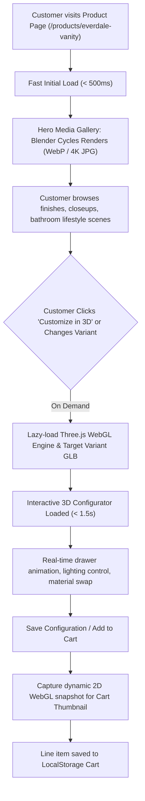
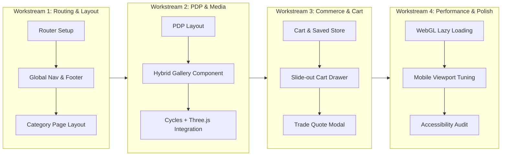

# Everdale — Phase 04 Implementation Plan
## Storefront Catalogue, Product Detail Pages (PDP), Hybrid 3D Galleries & Commerce Persistence

- **Project**: Everdale Configurable Cabinetry & Furniture Platform
- **Phase**: 04 — Storefront, Product Detail Pages & Hybrid Commerce Experience
- **Author**: Senior Full-Stack Architect & 3D E-Commerce Specialist
- **Status**: Draft / Roadmap
- **Target Repository**: `interactive-3d-viewer`

---

## 1. Executive Summary & Objective

Phase 03 established the scalable product data foundation for Everdale, including a decoupled `CatalogService`, normalized category and product family schemas, physical variant definitions with millimeter precision, deterministic pricing with promotional rebate calculations, asset binding registries, and draft schemas for kitchen cabinetry.

**Phase 04 transforms Everdale from a single-product 3D configurator into a multi-product luxury e-commerce platform.**

Key objectives for Phase 04:
1. **Multi-Page Storefront Navigation**: Introduce dedicated catalogue browsing (`/catalog`), category hubs (`/catalog/bathroom-vanities`), and Product Detail Pages (`/products/:productId`).
2. **Hybrid Visual Experience**: Seamlessly combine photorealistic Blender Cycles product renders (for instant visual hero galleries) with the interactive Three.js 3D configurator (for real-time customization).
3. **Product Discovery & Filtering**: Faceted filtering by width, mounting style (freestanding vs wall-mounted), basin configuration (single vs double), finish, and price range.
4. **Commerce Persistence**: Persistent shopping cart, custom quotation requests (hybrid purchase model), and saved customer configurations across browser sessions.
5. **Preservation & Non-Breaking Route Compatibility**: Ensure existing configurator bookmarks and URLs continue to load the 3D configurator directly without regression.

---

## 2. Phase 03 Prerequisites Delivered

Phase 04 directly leverages the domain services delivered in Phase 03:

| Phase 03 Deliverable | Module Location | Phase 04 Utilization |
| :--- | :--- | :--- |
| **Catalog Query Facade** | `src/catalog/index.js` | Feeds PLP card listings, category menus, and PDP initial data loading. |
| **Category & Family Metadata** | `src/catalog/categories.js`, `families.js` | Drives breadcrumbs, category navigation tiles, and family grouping. |
| **Variant & Specification Engine** | `src/catalog/variants.js` | Powers size selector chips, dimension callouts, and specification tables. |
| **Compatibility Engine** | `src/catalog/compatibility.js` | Prevents invalid option selections in the configurator and cart validation. |
| **Pricing & Rebate Calculator** | `src/catalog/pricing.js` | Provides exact subtotal, 11% rebate breakdown, and line items in cart/quote drawers. |
| **Commerce Eligibility Service** | `src/catalog/eligibility.js` | Determines whether an item routes to "Add to Cart" or "Request Custom Quote". |
| **Asset Registry** | `src/catalog/assets.js` | Populates PDP image carousels with Blender Cycles renders and lazy-loads GLB assets. |
| **URL State Serialization** | `src/utils/urlState.js` | Generates shareable configuration links for saved designs and quote PDF generation. |

---

## 3. Storefront Architecture & Routing

### 3.1 Routing Specification
Phase 04 introduces client-side routing using `react-router-dom` (or lightweight URL routing) integrated into Vite:

| Route | View Component | Description |
| :--- | :--- | :--- |
| `/` | `HomePage` | Brand landing page featuring hero imagery, category showcase, and featured collections. |
| `/catalog` | `CatalogPage` | Master catalogue index displaying all active categories and product families. |
| `/catalog/:categoryId` | `CategoryPage` | Filterable Product Listing Page (PLP) (e.g. `/catalog/bathroom-vanities`). |
| `/products/:productId` | `ProductDetailPage` | Rich PDP with hybrid photo/3D gallery, dimension tabs, specs, and price overview. |
| `/configure/:productId` | `ConfiguratorPage` | Full-screen interactive 3D configurator (with option drawer, dimension overlays, lighting). |
| `/cart` | `CartPage` / `CartDrawer` | Cart review with line-item pricing, promo discount, and checkout/quote triggers. |
| `/quote-request` | `QuoteRequestModal` | B2B / Custom trade quotation intake form pre-filled with active configuration. |

### 3.2 Legacy Compatibility & Rewrites
To guarantee that existing links (e.g. `/?w=31&d=22&f=white-oak...`) continue to work seamlessly:
- The router checks for legacy query parameters on root `/`.
- If configuration parameters (`w`, `d`, `f`, etc.) are detected without a path, the application seamlessly resolves to `ConfiguratorPage` with `productId = 'everdale-vanity'`.
- Clean URLs (`/configure/everdale-vanity?w=31...`) become the canonical share format.

---

## 4. Component Hierarchy Plan

```text
src/
├── app/
│   ├── App.jsx                       # Root application with RouterProvider and GlobalState
│   └── routes.jsx                    # Route mapping definition
├── catalog/                          # (Phase 03 Domain Architecture - Untouched)
├── components/
│   ├── common/
│   │   ├── Header.jsx                # Global navigation bar with category links and cart badge
│   │   ├── Footer.jsx                # Brand footer, technical documentation links, warranties
│   │   ├── Badge.jsx                 # "In Stock", "QuickShip", "11% Off", "Custom Order"
│   │   └── DimensionCallout.jsx      # Metric / Imperial dimensional badge
│   ├── storefront/
│   │   ├── CategoryCard.jsx          # Category tile with lifestyle Cycles photography
│   │   ├── ProductCard.jsx           # PLP card with quick-view, finish chips, and starting price
│   │   ├── FacetFilters.jsx          # Width, mounting type, basin count, finish filters
│   │   └── SortSelector.jsx          # Sort by price, width, popularity
│   ├── pdp/
│   │   ├── HybridMediaGallery.jsx    # Photo carousel + "Launch 3D Configurator" interactive toggle
│   │   ├── ProductSummary.jsx        # Title, SKU, starting price, rebate callout, stock status
│   │   ├── VariantSelector.jsx       # Physical size pills (24″, 31″, 37″, 49″, 61″)
│   │   ├── SpecificationTable.jsx    # Engineering specs, materials, clearances, certifications
│   │   └── ActionPanel.jsx           # "Customize in 3D", "Add to Cart", "Request Trade Quote"
│   ├── configurator/                 # (Existing Configurator Components Adapted)
│   │   ├── ConfiguratorLayout.jsx    # Fullscreen 3D viewport with floating control dock
│   │   ├── ThreeCanvas.jsx           # Three.js WebGL viewport (lazy-loaded)
│   │   ├── OptionPanel.jsx           # Modular tabbed option controls
│   │   └── PriceBreakdownModal.jsx   # Line-item pricing, rebate details, lead-time notice
│   └── commerce/
│       ├── CartDrawer.jsx            # Slide-out cart with configured line items and thumbnails
│       ├── SavedDesignsModal.jsx     # Saved configurations list with reload and share actions
│       └── QuoteModal.jsx            # Custom specification inquiry form for architectural trade
```

---

## 5. Hybrid 3D & Photography Visual Pipeline

Phase 04 unifies pre-rendered Blender Cycles imagery and real-time WebGL:



### Advantages:
- **Instant Core Web Vitals**: Customers on mobile or slower networks do not wait for multi-megabyte 3D engines to load before seeing photorealistic product imagery.
- **Visual Accuracy**: High-resolution Cycles renders showcase photorealistic raytraced contact shadows and caustics for marketing, while Three.js provides interactive exploration.
- **Unified Geometry**: Because Phase 02 established identical dimensions and UV mapping across Blender and GLB exports, the transition between photo and 3D is seamless.

---

## 6. Commerce & State Management Evolution

### 6.1 State Store Architecture (`src/store/`)
Phase 04 will introduce lightweight state stores (via Zustand or React Context + useReducer) without heavy external dependencies:

1. **`CartStore`**:
   - Manages items in cart: `{ id, productId, variantId, configuration, pricing, timestamp, customNotes }`.
   - Persists automatically to `localStorage` (`everdale_cart_v1`).
   - Supports line-item quantity, removal, and re-editing in the 3D configurator.

2. **`SavedDesignsStore`**:
   - Manages user-bookmarked designs with user-defined names (e.g. "Master Bath Renovation - White Oak").
   - Generates and parses shareable short-links.

3. **`ActiveConfigStore`**:
   - Holds the current product configuration during an active session.
   - Syncs seamlessly with `src/utils/urlState.js`.

### 6.2 Hybrid Purchase & Quotation Flow
Based on `CommerceEligibilityService`:
- **Direct Checkout (Standard Variants)**:
  - If `eligibility === 'in-stock'` or `'quickship'`: Trigger Shopify / Stripe / Direct Order intent with structured line-item breakdown.
- **Quotation Workflow (Custom Configurations / Trade Clients)**:
  - If `eligibility === 'semi-custom'` or customer selects trade inquiry:
  - Open `QuoteModal` generating a structured PDF summary including dimensions, selected finishes, GLB render snapshot, and total estimated price.

---

## 7. Implementation Workstreams & Phasing



### Workstream Schedule:
1. **Workstream 1: Foundation & Storefront Pages**
   - Install/configure client-side routing.
   - Build Header, Footer, Category Hub (`/catalog`), and PLP (`/catalog/:categoryId`).
   - Wire `CatalogService.getProductsByCategory()` and facet filtering.
2. **Workstream 2: Product Detail Page & Hybrid 3D Integration**
   - Implement `ProductDetailPage` with variant selection pills and spec sheets.
   - Build `HybridMediaGallery` supporting static Cycles images and embedded 3D viewer.
   - Ensure seamless transition to full-screen 3D configuration mode.
3. **Workstream 3: Cart, Saved Configurations & Quotation Intake**
   - Implement `CartStore` and slide-out `CartDrawer`.
   - Wire `PricingService.calculatePrice()` to dynamic cart line items.
   - Build Trade Quotation Modal with WebGL thumbnail capture.
4. **Workstream 4: Verification, Cross-Device Testing & Documentation**
   - Mobile touch optimization for 3D orbit controls and drawer gestures.
   - Lighthouse performance optimization (target Core Web Vitals > 90).
   - Author Phase 04 architectural and user guides.

---

## 8. Definition of Done for Phase 04

- [ ] All routes (`/`, `/catalog`, `/catalog/bathroom-vanities`, `/products/everdale-vanity`, `/configure/everdale-vanity`) load reliably without 404s.
- [ ] Legacy configurator URLs with query parameters automatically resolve to the full 3D configurator with matching selections.
- [ ] PLP provides working filters for size, style, and finish.
- [ ] PDP displays high-resolution Blender Cycles renders and launches the 3D configurator on demand.
- [ ] Full 3D configurator retains all existing capabilities (camera presets, lighting, drawer animations, dimension toggles).
- [ ] Cart drawer displays verified line-item pricing, 11% rebate discount, and lead-time estimates.
- [ ] Trade Quote Modal allows submission of custom configurations with instant configuration summary.
- [ ] Full regression test suite and production build pass with zero warnings or errors.
