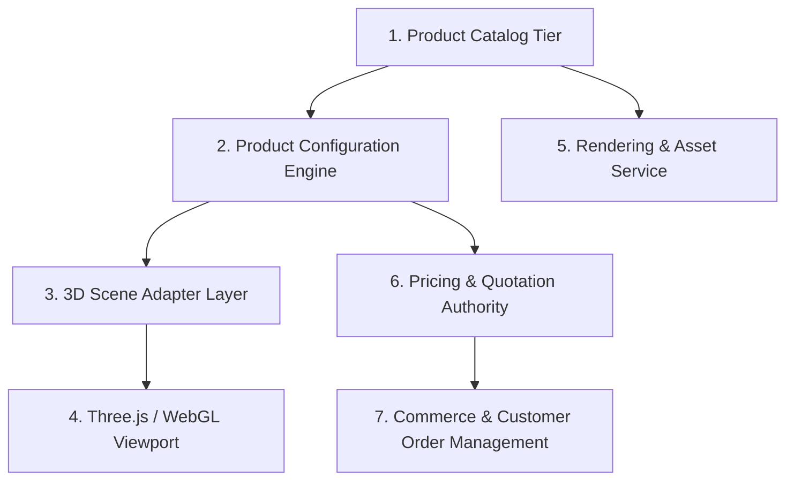
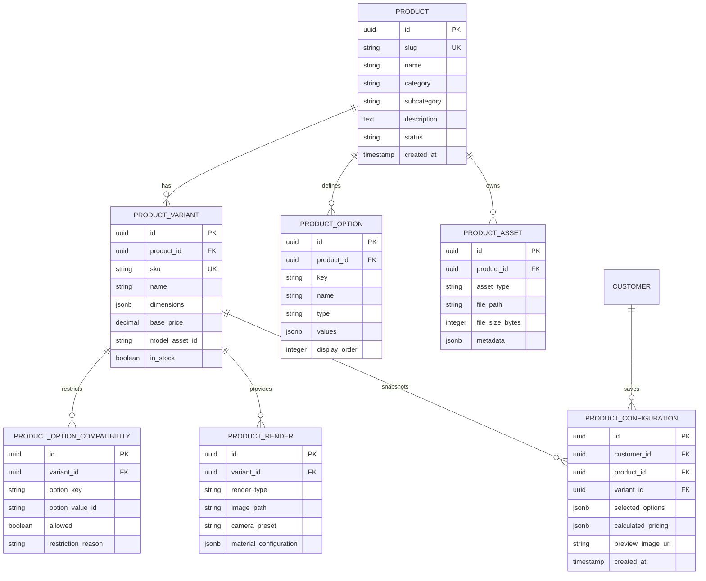

# Scalable Product Data Architecture — Everdale Platform (Phase 01)

**Document Version:** 1.0.0  
**Status:** Approved Architectural Standard  
**Author:** Enterprise Solutions Architect & Technical Project Lead  
**Scope:** Multi-Category Support (Bathroom Vanities, Kitchen Cabinets & Modular Storage)  
**Date:** November 2026  

---

## 1. Architectural Vision & Separation of Concerns

To evolve Everdale from a single-product vanity configurator into a multi-category luxury cabinetry platform, product data must be completely separated from Three.js scene mechanics.

The architecture decouples the system into seven discrete tiers:



1. **Product Catalog Tier**: Relational entity definitions, SKUs, categories, specifications, and dimensional bounds.
2. **Product Configuration Engine**: Pure functional rule engine governing compatible widths, finishes, handles, and accessories.
3. **3D Scene Adapter Layer (`ProductSceneAdapter`)**: Abstract interface bridging abstract product configurations to WebGL rendering engines.
4. **Rendering & Asset Service**: Storage and CDN delivery for GLBs, HDRIs, procedural materials, and Blender Cycles offline marketing renders.
5. **Pricing & Quotation Authority**: Server-authoritative price calculation, deposit schedules, and discounts.
6. **Commerce & Customer Tier**: Persistent cart, customer accounts, saved configuration snapshots, order tracking.

---

## 2. Relational Entity-Relationship Model



---

## 3. Product Scene Adapter Interface (`ProductSceneAdapter`)

Rather than injecting kitchen cabinet logic into `VanitySceneManager.js`, all 3D scene implementations adhere to a standard lifecycle interface:

```typescript
export interface ProductSceneAdapter {
  readonly productId: string;
  readonly isLoaded: boolean;
  
  // Lifecycle
  init(container: HTMLElement, options: SceneOptions): Promise<void>;
  loadModel(variant: ProductVariant, config: ConfigurationState): Promise<void>;
  switchVariant(variant: ProductVariant, config: ConfigurationState): Promise<void>;
  applyConfiguration(config: ConfigurationState): void;
  dispose(): void;

  // Interactivity
  setCameraPreset(presetName: string): void;
  toggleInteractiveComponent(componentId: string): void;
  resetInteractiveComponents(): void;
  captureSnapshot(format: 'png' | 'webp', resolutionMultiplier?: number): string;
  
  // Event callbacks
  on(event: 'loaded' | 'progress' | 'error' | 'interaction', handler: Function): void;
}
```

- **`VanitySceneAdapter`**: Implements the bathroom vanity series with soft-close drawers and mirror/faucet procedural pairing.
- **`KitchenCabinetSceneAdapter`**: Implements kitchen base/wall cabinets, corner lazy-susans, soft-close door hinges, and customizable plinth toe-kicks.

---

## 4. Concrete Category JSON Schemas

### 4.1 Category 1: Bathroom Vanity Sample (`everdale-vanity-31.json`)
```json
{
  "id": "prod_vanity_everdale_31",
  "slug": "everdale-31-single-vanity",
  "name": "Everdale 31″ Single Bathroom Vanity",
  "category": "bathroom",
  "subcategory": "vanities",
  "status": "active",
  "leadTime": {
    "inStock": "Immediate dispatch",
    "quickship": "3-5 weeks",
    "semiCustom": "5-7 weeks"
  },
  "specifications": {
    "mountingType": "Freestanding",
    "cabinetMaterial": "Solid Wood & Furniture-Grade MDF",
    "countertopMaterial": "Engineered Stone",
    "basinType": "Integrated Rectangular Porcelain Basin",
    "drawerSlideType": "Undermount Soft-Close Full-Extension",
    "faucetDrilling": "4″ Centerset (3-hole pre-drilled)"
  },
  "dimensions": {
    "overallWidthMm": 787.4,
    "overallDepthMm": 482.6,
    "cabinetHeightMm": 863.6,
    "backsplashHeightMm": 101.6,
    "overallHeightMm": 965.2
  },
  "variants": [
    {
      "id": "var_vanity_24",
      "sku": "605-9530",
      "name": "Everdale 24″",
      "widthIn": 24,
      "basePrice": 699.00,
      "modelAsset": "/models/Everdale_24_Vanity_Interactive.glb"
    },
    {
      "id": "var_vanity_31",
      "sku": "605-9531",
      "name": "Everdale 31″",
      "widthIn": 31,
      "basePrice": 799.00,
      "modelAsset": "/models/Everdale_31_Vanity_Interactive.glb"
    },
    {
      "id": "var_vanity_61",
      "sku": "605-9534",
      "name": "Everdale 61″ Double",
      "widthIn": 61,
      "basePrice": 1399.00,
      "modelAsset": "/models/Everdale_61_Vanity_Interactive.glb"
    }
  ],
  "configurableOptions": [
    {
      "key": "finish",
      "label": "Cabinet Finish",
      "type": "pbr_material",
      "targetSemanticRole": "cabinet_body",
      "values": [
        { "id": "evergreen-fog", "name": "Evergreen Fog", "hex": "#899281", "priceDelta": 0 },
        { "id": "midnight-blue", "name": "Midnight Blue", "hex": "#2b3d52", "priceDelta": 30 }
      ]
    },
    {
      "key": "hardware",
      "label": "Hardware Finish",
      "type": "pbr_material",
      "targetSemanticRole": "hardware",
      "values": [
        { "id": "antique-brass", "name": "Antique Brass", "hex": "#b08b4f", "metalness": 0.88, "priceDelta": 0 },
        { "id": "matte-black", "name": "Matte Black", "hex": "#232528", "metalness": 0.35, "priceDelta": 24 }
      ]
    }
  ]
}
```

### 4.2 Category 2: Kitchen Cabinet Sample (`everdale-kitchen-base-36.json`)
```json
{
  "id": "prod_kitchen_everdale_base_36",
  "slug": "everdale-36-kitchen-base-cabinet",
  "name": "Everdale 36″ 2-Door 1-Drawer Kitchen Base Cabinet",
  "category": "kitchen",
  "subcategory": "base_cabinets",
  "status": "active",
  "leadTime": {
    "inStock": "1-2 weeks",
    "semiCustom": "4-6 weeks"
  },
  "specifications": {
    "boxConstruction": "3/4″ Plywood Carcass with Maple Veneer",
    "doorStyle": "Shaker 5-Piece Solid Hardwood",
    "hingeType": "Blum Soft-Close 110° Concealed",
    "drawerSlideType": "Blum Tandembox Full Extension 50kg",
    "toeKickHeightMm": 114.3
  },
  "dimensions": {
    "widthMm": 914.4,
    "depthMm": 609.6,
    "heightMm": 876.3
  },
  "variants": [
    {
      "id": "var_kitchen_base_30",
      "sku": "KB-30-2D1D",
      "name": "30″ Base Cabinet",
      "basePrice": 549.00,
      "modelAsset": "/models/kitchen/Everdale_Kitchen_Base_30.glb"
    },
    {
      "id": "var_kitchen_base_36",
      "sku": "KB-36-2D1D",
      "name": "36″ Base Cabinet",
      "basePrice": 629.00,
      "modelAsset": "/models/kitchen/Everdale_Kitchen_Base_36.glb"
    }
  ],
  "configurableOptions": [
    {
      "key": "doorStyle",
      "label": "Door Profile",
      "type": "mesh_variant",
      "targetSemanticRole": "cabinet_fronts",
      "values": [
        { "id": "shaker-slim", "name": "Slim Shaker", "priceDelta": 0 },
        { "id": "flat-slab", "name": "Modern Slab", "priceDelta": -20 },
        { "id": "raised-panel", "name": "Traditional Raised", "priceDelta": 45 }
      ]
    },
    {
      "key": "finish",
      "label": "Cabinet Finish",
      "type": "pbr_material",
      "targetSemanticRole": "cabinet_fronts",
      "values": [
        { "id": "natural-white-oak", "name": "Natural White Oak", "texture": "/textures/wood_oak.jpg", "priceDelta": 65 },
        { "id": "painted-sage", "name": "Chantilly Sage", "hex": "#7d8b80", "priceDelta": 0 }
      ]
    },
    {
      "key": "countertop",
      "label": "Kitchen Countertop Slab",
      "type": "pbr_material",
      "targetSemanticRole": "countertop",
      "values": [
        { "id": "none", "name": "No Countertop (Cabinet Only)", "priceDelta": 0 },
        { "id": "calacatta-gold-quartz", "name": "Calacatta Gold Quartz 3cm", "priceDelta": 380 }
      ]
    }
  ]
}
```

---

## 5. Migration Strategy

1. **Phase 01**: Maintain existing `productConfig.js` for zero-regression stability while documenting the target JSON schema.
2. **Phase 02**: Introduce `ProductSceneAdapter` abstraction in the 3D layer and externalize catalog definitions into JSON schemas backed by mock API endpoints or database fixtures.
