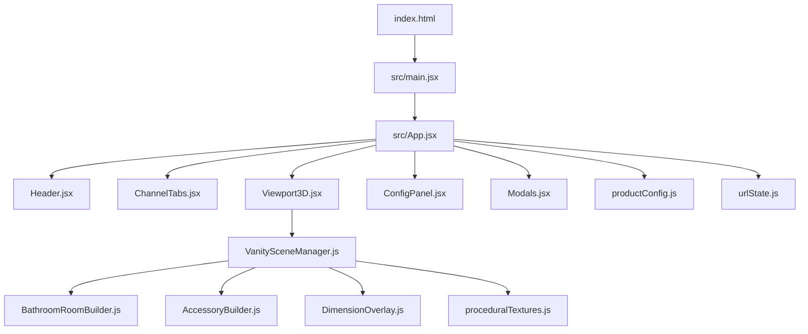

# Repository & Codebase Audit — Everdale Platform (Phase 01)

**Document Version:** 1.0.0  
**Status:** Approved Baseline  
**Author:** Senior Full-Stack Architect & Technical Project Lead  
**Target Application:** Everdale Interactive 3D Product Configurator  
**Repository:** `https://github.com/Vinoth-design/interactive-3d-viewer`  
**Date:** November 2026  

---

## 1. Executive Summary

This codebase audit evaluates the existing interactive 3D product configurator for the **Everdale Bathroom Vanity Series**. The current application is a high-performing single-page application built with **React 18**, **Vite 6**, and direct **Three.js (WebGL)**, complemented by Blender Cycles production assets and GLB/glTF delivery.

The application successfully provides:
- Real-time 3D product rendering with image-based lighting (HDR studio maps).
- Dynamic PBR material swapping (cabinet finishes, hardware, countertop stone, backsplash).
- Multi-size variant support (24″, 31″, 37″, 49″, and 61″ double-basin vanity).
- Interactive kinematic drawer animations (open, soft-close).
- Architectural staging (parametric walls, floors, lighting presets, styling accessories).
- Interactive dimension overlays and responsive camera presets.

This audit establishes the technical baseline, identifies structural and lifecycle limitations, and defines the stabilization requirements for Phase 01.

---

## 2. Technology Stack & Dependency Inventory

### 2.1 Core Runtime Stack
| Layer | Technology | Version | Purpose |
| :--- | :--- | :--- | :--- |
| **Frontend Framework** | React | `^18.3.1` | Declarative UI state, component hierarchy |
| **DOM Renderer** | React DOM | `^18.3.1` | Browser DOM reconciliation |
| **3D Engine** | Three.js | `^0.170.0` | Direct WebGL scene graph, shaders, loaders, post-processing |
| **Motion & Physics UI** | Framer Motion | `^14.14.0` | Spring animations for modals, drawer trays, retail price counter |
| **Iconography** | Lucide React | `^0.469.0` | Vector UI icons |
| **Build Tool & Bundler** | Vite | `^6.0.3` (Engine: Rollup) | Fast HMR dev server and ES module production bundler |
| **JSX Transform** | `@vitejs/plugin-react` | `^4.3.4` | Fast Refresh Babel/Babel-SWC JSX compiler |

### 2.2 3D Graphics & Asset Stack
| Technology / Format | Usage in Everdale | Implementation Details |
| :--- | :--- | :--- |
| **glTF 2.0 / GLB** | 3D Asset Transport | Binary `.glb` container with embedded buffers, PBR materials, and NLA animation clips |
| **RGBELoader** | Image-Based Lighting | Loads `.hdr` equirectangular maps (`studio_small_09_1k.hdr`, `warm_studio_1k.hdr`) |
| **PMREMGenerator** | Radiance Filtering | Pre-filters HDRIs to specular mipmap environment cubes for physically accurate metal/roughness reflections |
| **EffectComposer** | Post-Processing | `RenderPass` + `UnrealBloomPass` (emissive sconces & brass specular) + `OutputPass` with `ACESFilmicToneMapping` |
| **Procedural Textures** | Runtime Generation | Canvas2D dynamic normal/diffuse generation for Carrara marble veining and quartz speckles |

---

## 3. Directory Structure

```text
interactive 3d model viewer/
├── .git/                                # Git version control
├── .gitignore                           # Git ignore rules (node_modules, dist, .blend1)
├── README.md                            # Project overview & quickstart
├── index.html                           # Root static HTML wrapper
├── launch_configurator.bat              # Windows batch launcher (Vite dev)
├── launch_viewer.bat                    # Windows batch launcher (static preview)
├── 3d model/                            # Design references & dimensional specifications
├── Everdale_Vanity/                     # Source Blender workspace & production pipeline
│   ├── 02_Modelling/                    # Raw mesh blockouts
│   ├── 03_Drawer_Assembly/              # Undermount slide mechanics & caddies
│   ├── 04_Exterior_Detailing/           # Bevels, sink basins, and faucet drillings
│   ├── 05_Materials/                    # Cycles PBR material node networks
│   ├── 06_Animation/                    # Keyframed NLA soft-close tracks
│   ├── 07_Export/                       # Approved production Blender files & GLBs
│   ├── DOCUMENTATION/                   # 3D pipeline technical specifications
│   ├── generate_all_sizes.py            # Parametric size generator script (Blender bpy)
│   └── generate_everdale_portfolio.py   # Multi-angle render generator script
├── documentation/                       # Enterprise architecture & audit documentation (Phase 01)
│   ├── architecture/                    # Systems architecture & technical audits
│   ├── 3d-pipeline/                     # glTF hierarchy, asset inventory & rendering workflows
│   ├── products/                        # Catalog definitions & dimensional verification
│   └── testing/                         # Baseline reports, performance & regression checklists
└── everdale-configurator/               # Production Web Application (React + Three.js)
    ├── dist/                            # Production build output
    ├── public/
    │   ├── models/                      # Production interactive GLBs (24", 31", 37", 49", 61")
    │   └── textures/                    # CC0 1K Studio & Warm Bath HDRIs
    ├── src/
    │   ├── components/
    │   │   ├── ChannelTabs.jsx          # In-Stock, Quickship, Semi-Custom channel selector
    │   │   ├── ConfigPanel.jsx          # Accordion configuration controls & price breakdown
    │   │   ├── Header.jsx               # Navigation bar, brand badge, and quick actions
    │   │   ├── Modals.jsx               # Scene Settings, AR (QR), Share, Help, Scan, Cart drawer
    │   │   └── Viewport3D.jsx           # Canvas container, floating toolbar, camera pills
    │   ├── config/
    │   │   └── productConfig.js         # Master catalog options, dimensions, finishes, pricing rules
    │   ├── three/
    │   │   ├── AccessoryBuilder.js      # Procedural 4" centerset faucet and mirrors
    │   │   ├── BathroomRoomBuilder.js   # Room walls, floors, wall sconces, contact shadows
    │   │   ├── DimensionOverlay.js      # Three.js 3D dimensional line guides & dimension tags
    │   │   └── VanitySceneManager.js    # Core Three.js engine (lighting, GLTF loading, animations)
    │   ├── utils/
    │   │   ├── proceduralTextures.js    # Canvas2D procedural stone textures
    │   │   └── urlState.js              # URL search parameter reading & serialization
    │   ├── App.jsx                      # Application root, master state, drawer triggers
    │   ├── index.css                    # Glassmorphism design tokens & responsive CSS
    │   └── main.jsx                     # Vite React entry point
    ├── package.json                     # Dependency manifests & scripts
    └── vite.config.js                   # Vite configuration with React plugin
```

---

## 4. Main Application Entry Points & Component Hierarchy



### 4.1 Component Responsibilities
1. **`App.jsx`**:
   - Holds the master application state (`config`, `cartItems`, `isSaved`, `activeModal`, `toastMsg`).
   - Syncs active configuration to browser URL parameters.
   - Computes live pricing using memoized `calculatePricing(config)`.
   - Manages top-level modal dialogs and notification banners.

2. **`Viewport3D.jsx`**:
   - Manages the WebGL canvas DOM mounting and unmounting lifecycle.
   - Instantiates `VanitySceneManager`.
   - Renders floating viewport controls (Camera view pills, Zoom in/out, Fullscreen, AR, Scene settings, Snapshot).
   - Renders loading spinner overlay during initial model retrieval.

3. **`ConfigPanel.jsx`**:
   - Organizes configuration steps: Sizing (Width, Depth), Cabinet Paint, Hardware, Countertop, Backsplash, Faucets, Mirrors.
   - Provides instant visual swatches with accessibility focus states.
   - Renders the live pricing summary, promotional rebate estimate, and primary CTA.

4. **`VanitySceneManager.js`**:
   - Encapsulates Three.js scene graph, renderer, lighting, cameras, post-processing composer, animation mixers, and raycasting.
   - Decoupled from React render cycle; communicates via callbacks (`onLoaded`, `onProgress`, `onError`, `onDrawerStateChange`).

---

## 5. Data Flow Architecture

The application follows a unidirectional data flow:
1. **State Initialization**: `readConfigFromUrl()` reads query parameters or falls back to `DEFAULT_CONFIG`.
2. **User Interaction**: User clicks a configuration option in `ConfigPanel.jsx`, `ChannelTabs.jsx`, or viewport controls.
3. **State Mutation**: `updateConfig({ finish: 'matte-white' })` shallowly merges the patch into React state.
4. **Side Effects**:
   - `useEffect([config])` calls `syncConfigToUrl(config)` to update `window.history.replaceState`.
   - `calculatePricing(config)` recalculates subtotal, discounts, and itemized breakdown.
   - `useEffect([config])` in `Viewport3D.jsx` calls `managerRef.current.applyConfig(config)`.
5. **3D Scene Updates**:
   - If `config.width` changed, `switchModel` requests the corresponding GLB asset.
   - If finish/hardware/countertop changed, materials are mutated in-place on existing meshes (`color.set()`, `needsUpdate = true`), executing in $\le 1\text{ ms}$ with zero network overhead.

---

## 6. Codebase Strengths

1. **Lightweight & Fast**: Production JavaScript bundle is $\approx 1.05\text{ MB}$ uncompressed ($\approx 296\text{ KB}$ gzipped), loading in under 1 second.
2. **In-Place Material Swapping**: High-quality PBR material manipulation is decoupled from geometry loading, delivering instant 60 FPS visual response.
3. **Photorealistic Real-Time Rendering**: Balanced lighting with dual HDR environment support, `ACESFilmicToneMapping`, and subtle bloom creates a tactile, luxurious presentation.
4. **Physically Accurate Kinematics**: Keyframed NLA soft-close curves simulate realistic undermount hydraulic damping rather than linear robotic transitions.
5. **Comprehensive Sizing Coverage**: Five pre-modeled width variants (24″, 31″, 37″, 49″, 61″) with dedicated dual-basin kinematics on the 61″ model.

---

## 7. Technical Limitations & Risks Identified

1. **Race Condition in Model Switching (Critical)**:
   Rapidly toggling vanity sizes triggers multiple asynchronous `GLTFLoader.load` calls. The existing `_loadingUrl` guard does not track request generation tokens. If an earlier request finishes after a later selection, the stale model will replace the active selection.
2. **GPU Memory Leak on Model Replacement (High)**:
   In `switchModel`, previous `modelRoot` children are removed from the scene graph without disposing their `BufferGeometry`, `Material`, and texture memory. Frequent size switching causes progressive VRAM accumulation.
3. **Duplicate Initialization Logic (Medium)**:
   `loadModel` and `switchModel` share 80 lines of duplicate setup logic, creating maintenance friction and divergence risk.
4. **Unvalidated URL Configuration State (Medium)**:
   `readConfigFromUrl` accepts arbitrary string values from query parameters without validating them against `productConfig.js` catalogs, potentially causing unselected UI controls or runtime warnings.
5. **Initial Load Model Redundancy (Low)**:
   `Viewport3D.jsx` hardcodes `Everdale_31_Vanity_Interactive.glb` on mount, triggering an immediate second load if the URL specified `width=24` or `width=49`.
6. **Client-Side Pricing & Transient Commerce State (Architecture Gap)**:
   Pricing, cart items, and save states reside solely in client memory. No backend authority or persistent storage exists yet.

---

## 8. Architectural Recommendations for Phase 01

1. **Implement Request Generation Guard**: Wrap asynchronous model loading in an atomic token comparison (`currentGen === this._loadGeneration`) to completely prevent stale model replacement.
2. **Implement Mesh & Buffer Cleanup**: Recursively traverse replaced models and invoke `.dispose()` on geometries and unique materials.
3. **Consolidate Setup Logic**: Extract `_initModel(gltf, url)` to serve both `loadModel` and `switchModel`.
4. **Add URL Parameter Validation**: Sanitize query parameters against known catalog IDs with safe defaults.
5. **Direct Model Initialization**: Pass `config.width`'s model file directly to `loadModel` on mount.
6. **Maintain Separation of Concerns**: Keep product business data strictly decoupled from Three.js scene mechanics to facilitate future kitchen cabinet and wardrobe product lines.
