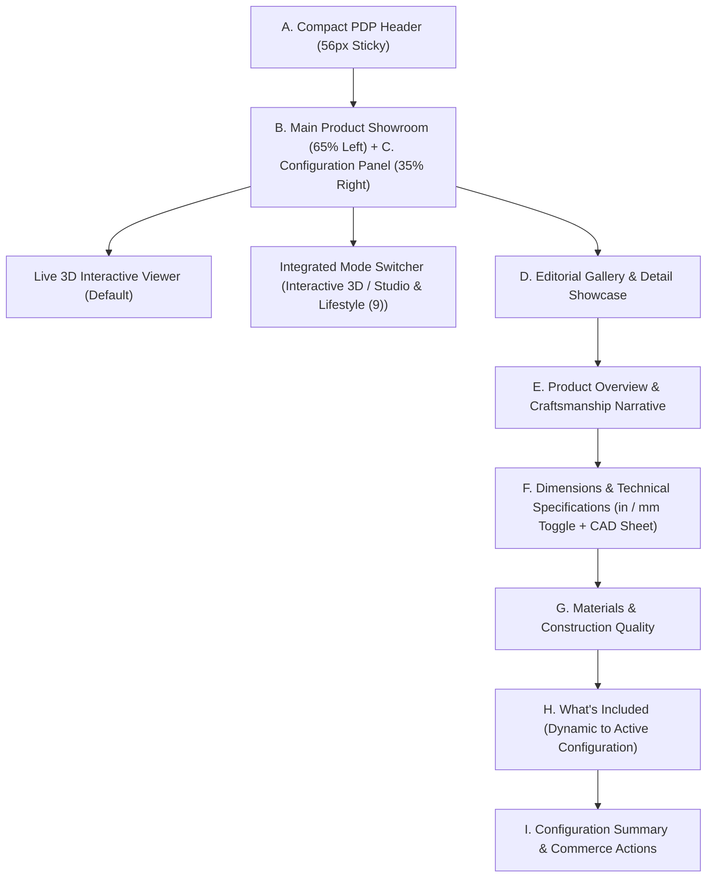

# Everdale — PDP Layout and Interaction Specification

**Document ID:** `PDP_LAYOUT_AND_INTERACTION_SPECIFICATION`  
**Version:** 1.0.0  
**Status:** Active Specification  

---

## 1. Page Architecture & Section Sequence

The PDP flows cleanly from an above-the-fold interactive showroom into structured editorial product documentation below the fold:

### Section Breakdown
- **A. Compact Header**: Single-row sticky navigation (`56px`). Displays brand identity (`Everdale Bath Studio`), active variant title & SKU pill, quick `Showroom Tag (SKU)` lookup, `Saved` indicator, `Bag / Quote` count, and `Viewer Guide`. No multi-page storefront links or unrequested search bars.
- **B. Main Product Showroom (Hero Left Column)**:
  - Occupies `65%` (`minmax(0, 1.85fr)`) on desktop (`>= 1200px`), `60%` on laptop (`1024px–1199px`).
  - Houses a prominent full-height stage (`min-height: 540px`, `height: calc(100vh - 56px)` cleanly filling the viewport below the sticky header) with instant top-right toggle between **Interactive 3D** and **Studio & Lifestyle (9)**.
  - Inside **Interactive 3D**, camera presets (`3/4 View`, `Front`, `Side`, `Top`, `Detail`, `Drawers`, and `Reset`) anchor top-left, interactive canvas controls anchor on the right rail, and a minimal interaction hint pill (`Drag to rotate · Right-drag to pan · Scroll to zoom · Click drawers in 3D`) sits centered along the bottom edge without extra overlay docks or thumbnail strips below the canvas.
- **C. Product Configuration Panel (Hero Right Column)**:
  - Occupies `35%` (`minmax(380px, 460px)`).
  - Sticky or naturally scrollable alongside the showroom, organized cleanly into:
    1. Title, Family label, SKU, and Overall Dimensions summary.
    2. Fulfillment Channel tabs (`In stock`, `Quickship`, `Semi-custom`) + verified Price & Savings summary + Primary CTA & Save/Share actions.
    3. Core Product Options (Width, Depth status, Cabinet Finish, Hardware Finish, Countertop & Backsplash).
    4. Expandable Additional Fittings (`Faucet & Drain Trim`, `Matching Mirror & Frame`, `Interior Organization`) and collapsible `Showroom Environment & Lighting`.
- **D–I. Below-the-Fold Editorial Sections**:
  - Constrained inside a centered `max-width: 1360px` container with generous padding (`56px–72px` vertical rhythm) and alternating clean surfaces.
  - Anchor quick-jump pills (`Overview`, `Dimensions & Specs`, `Materials`, `What's Included`, `Summary`) let shoppers jump directly to technical specifications without scrolling endlessly.

---

## 2. Interaction Flows & Micro-Interactions

1. **Zero-Reload Configuration Sync**:
   - Changing finish, hardware, countertop, backsplash, faucet, mirror, room wall, floor, or lighting updates Three.js scene state immediately via `VanitySceneManager.applyConfig(config)` with zero GLB re-fetch.
   - Changing width (`24″`–`61″`) triggers async GLB swap guarded by `_loadGeneration` and smoothly reframes the camera.
2. **Bidirectional Gallery ↔ 3D Sync**:
   - Switching to **Studio & Lifestyle (9)** in the top-right showroom switcher displays verified imagery inside the hero frame (with prev/next controls, click-to-open Lightbox zoom, keyboard arrows, and Lightbox thumbnails) alongside a one-click `"Inspect in Live 3D"` action that restores the WebGL canvas and animates the camera to the corresponding angle (opening drawers when inspecting drawer-open media).
3. **Lightbox & Touch Gestures**:
   - Fullscreen photo lightbox supports keyboard (`ArrowLeft`, `ArrowRight`, `Escape`), pointer click-to-zoom (`1x` / `2x` pan), and horizontal touch swipe (`touchstart`/`touchend` delta threshold `40px`).
4. **Honest Commerce Feedback**:
   - `In stock` adds configured item to the local **Project Bag & Quote Summary Drawer** (`CartDrawer`), explicitly marked as a client-side specification/bag preview (no fake payment submission).
   - `Quickship` / `Semi-custom` opens the **Quote Specification Drawer/Modal**, allowing the user to review, copy, or download their itemized specification summary without simulating a fake server order confirmation.

---

## 3. Responsive Breakpoints

| Viewport Tier | Width Range | Showroom / Config Split | Sticky Actions |
| :--- | :--- | :--- | :--- |
| **Wide Desktop** | `>= 1280px` | `65% / 35%` (`1fr 440px`–`480px`) sticky viewport | Inline in panel |
| **Compact Laptop** | `1024px – 1279px` | `60% / 40%` (`1fr 400px`) sticky viewport | Inline in panel |
| **Tablet** | `768px – 1023px` | Stacked: `56vh` (`min 440px`) Showroom top + 2-col editorial config grid below | Floating bottom summary bar |
| **Mobile** | `<= 767px` | Stacked: `50vh` (`min 360px`) Showroom top + compact title/price + touch-friendly horizontal/wrapped swatches | Sticky bottom action bar (`min-height: 64px` + safe area) |
