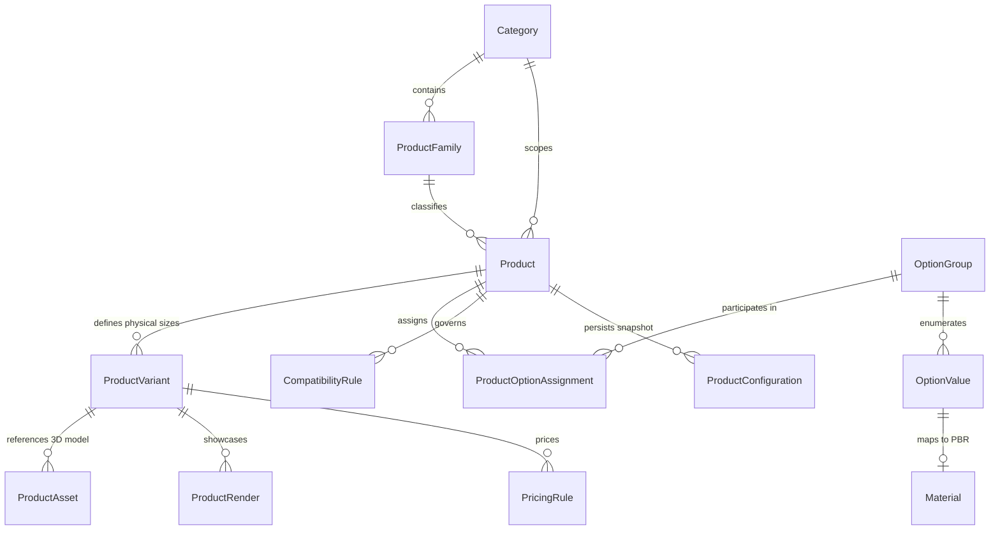

# Everdale Product Platform: Catalogue Data Model Specification
**Version**: 3.0.0  
**Status**: APPROVED & ACTIVE  
**Last Updated**: 2026-11-24  
**Applicability**: E-Commerce Catalog, Relational Data Schemas, Configuration Engine & 3D Integration

---

## 1. Architectural Principles & Domain Boundaries

The Everdale product catalog architecture decouples physical product inventory from configuration options, rendering assets, and presentation layers. Rather than treating an entire configured product as a flat document, the system decomposes products into thirteen normalized entities grouped into four logical subdomains:

```
[ Catalog Subdomain ]              [ Configuration Subdomain ]
  Category                           OptionGroup
    └── ProductFamily                  └── OptionValue
          └── Product                    └── CompatibilityRule
                └── ProductVariant         └── ProductOptionAssignment

[ Asset & Material Subdomain ]     [ Commerce & Pricing Subdomain ]
  ProductAsset                       PricingRule
  ProductRender                      ProductConfiguration
  Material                           CommerceEligibility
```

---

## 2. Entity Relationship Overview



---

## 3. Detailed Entity Definitions

### 3.1 `Category`
Top-level navigational and merchandising division.
- `id` (string, PK): Slug identifier (e.g., `bathroom-vanities`, `kitchen-cabinets`).
- `name` (string, required): Human-readable name.
- `slug` (string, unique, required): URL segment.
- `description` (string, optional): Category overview copy.
- `image` (string, optional): High-resolution hero image URL.
- `display_order` (integer, default: 0): Sorting weight.
- `status` (enum: `'published' | 'draft' | 'archived'`, default: `'published'`).

### 3.2 `ProductFamily`
Architectural classification grouping products that share identical construction types, kinematic rules, and installation profiles.
- `id` (string, PK): e.g., `freestanding-vanity`, `kitchen-base-cabinet`.
- `category_id` (string, FK -> Category.id): Parent category.
- `name` (string, required): e.g., "Freestanding Bathroom Vanity".
- `configuration_type` (enum: `'single-assembly' | 'modular-system'`).
- `scene_adapter` (string, required): Three.js driver class (e.g., `VanitySceneAdapter`, `KitchenSceneAdapter`).
- `status` (enum: `'published' | 'draft'`).

### 3.3 `Product`
The master marketable product entity.
- `id` (string, PK): Unique product identifier (e.g., `everdale-vanity`).
- `family_id` (string, FK -> ProductFamily.id).
- `category_id` (string, FK -> Category.id).
- `name` (string, required): e.g., "Everdale Bathroom Vanity Combo".
- `slug` (string, unique, required).
- `brand` (string, required): "Everdale Bath Studio".
- `short_description` (string).
- `full_description` (text).
- `features` (jsonb array): Highlight bullet points.
- `specifications` (jsonb object): Technical manufacturing details.
- `default_variant_id` (string, FK -> ProductVariant.id).
- `pricing_mode` (enum: `'configurable' | 'variant-based' | 'quote-required'`).
- `purchase_enabled` (boolean, default: true).
- `quote_enabled` (boolean, default: true).
- `status` (enum: `'published' | 'draft' | 'archived'`).

### 3.4 `ProductVariant`
A physical manufactured size variant of a product.
- `id` (string, PK): e.g., `vanity-31`.
- `product_id` (string, FK -> Product.id).
- `sku` (string, unique, required): e.g., `605-9531`.
- `name` (string, required): e.g., "Everdale 31″ Single Vanity".
- `dimensions` (jsonb):
  - `topWidthMm` (float), `baseWidthMm` (float)
  - `depthMm` (float), `heightMm` (float), `backsplashMm` (float)
  - `basinCount` (integer: 1 or 2)
- `model_asset_id` (string, FK -> ProductAsset.id).
- `base_price` (decimal, required): Base price in USD.
- `availability_status` (enum: `'in-stock' | 'quickship' | 'backorder' | 'made-to-order'`).
- `status` (enum: `'published' | 'draft'`).

### 3.5 `OptionGroup`
A category of customer-selectable features.
- `id` (string, PK): e.g., `finish`, `hardware`, `countertop`, `faucet`, `mirror`.
- `name` (string, required): Display label (e.g., "Cabinet Finish").
- `selection_type` (enum: `'single' | 'multi' | 'boolean' | 'quantity'`).
- `required` (boolean, default: true).
- `display_order` (integer).
- `configuration_scope` (enum: `'product' | 'visualisation'`).

### 3.6 `OptionValue`
An individual selection choice within an OptionGroup.
- `id` (string, PK): e.g., `evergreen-fog`, `carrara-marble`, `antique-brass`.
- `option_group_id` (string, FK -> OptionGroup.id).
- `label` (string, required): User-facing option name.
- `description` (string, optional).
- `swatch` (jsonb): Hex codes, thumbnail URLs, or gradient CSS.
- `material_id` (string, optional, FK -> Material.id).
- `price_adjustment` (decimal, default: 0.00).
- `price_multiplier` (enum: `'flat' | 'per-basin' | 'per-linear-foot'`, default: `'flat'`).
- `status` (enum: `'active' | 'discontinued'`).

### 3.7 `CompatibilityRule`
Declarative constraint ensuring mutually exclusive or dependent options are validated.
- `id` (string, PK).
- `product_id` (string, FK -> Product.id).
- `rule_type` (enum: `'requires' | 'incompatible' | 'filter-options'`).
- `condition` (jsonb): Trigger criteria (e.g., `{ "variantId": "vanity-61" }`).
- `result` (jsonb): Enforced state (e.g., `{ "mirrorFactor": 1.7, "basinMultiplier": 2 }`).
- `message` (string): Helpful user-facing explanation if an invalid combination is selected.

### 3.8 `ProductAsset`
Registry record tracking 3D models, textures, and HDRI environments.
- `id` (string, PK): e.g., `glb-vanity-31`.
- `product_id` (string, FK -> Product.id).
- `variant_id` (string, optional, FK -> ProductVariant.id).
- `asset_type` (enum: `'model-glb' | 'blender-source' | 'hdri' | 'texture-map'`).
- `file_path` (string, required): URL / relative path.
- `format` (string): `'glb'`, `'blend'`, `'png'`, `'hdr'`.
- `file_size_bytes` (integer).
- `version` (string): e.g., `'2.0.0'`.
- `validation_status` (enum: `'validated' | 'pending' | 'failed'`).

### 3.9 `ProductRender`
Pre-rendered offline photorealistic Blender Cycles imagery for PDP galleries and catalogues.
- `id` (string, PK).
- `product_id` (string, FK -> Product.id).
- `variant_id` (string, FK -> ProductVariant.id).
- `render_type` (enum: `'hero' | 'lifestyle' | 'front' | 'side' | 'countertop-detail' | 'hardware-detail' | 'drawer-open'`).
- `image_path` (string, required): Master PNG or high-res WebP.
- `dimensions` (string): e.g., `'1800x1200'`.
- `camera_preset` (string).
- `status` (enum: `'published' | 'draft'`).
